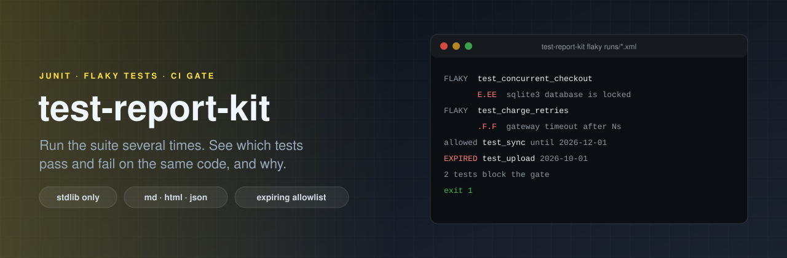

<p align="center"></p>

# test-report-kit

[](https://github.com/ErenOzgu/test-report-kit/actions/workflows/ci.yml)


**Find the flaky tests.** Run your suite a few times on the same code, give test-report-kit the JUnit XML files, and
it tells you which tests passed in some runs and failed in others, which fail every time, which failures are really
the same failure, and which tests are slow. The answer is one Markdown, HTML or JSON file. A second command is a CI
gate: it exits 1 when a flaky test is not on an allowlist, and every allowlist entry has an end date, so
"we'll fix it later" cannot quietly turn into "never".

Python standard library only. It reads files; it never runs your tests and never needs a network (except the optional
AI triage, below, which is off unless you ask for it).

## Why

One red build tells you a test failed. It does not tell you whether the test is broken or just unlucky. The usual
answer is to re-run the job and hope, and after a while nobody trusts a red build. The evidence is already there if
you keep the reports of several runs: a test that failed twice in five runs of the same commit is flaky, and a test
that failed five times in five is simply broken, and they need different fixes. And when thirty tests fail with the
same `database is locked`, you want to see one cause, not thirty lines.

## Try it

```sh
pip install git+https://github.com/ErenOzgu/test-report-kit      # or: git clone, then pip install .
test-report-kit report examples/runs/before/*.xml --title "Checkout service: 4 runs of one commit"
```

`examples/runs/before/` holds four JUnit files from four runs of one synthetic project (made up for this repository,
no real data). Each file is one run. The report starts like this
([the whole report](examples/out/report.md), [as a page](examples/out/report.html),
[as JSON](examples/out/report.json)):

<!-- excerpt:examples/out/report.md -->
## Failing in every run (1)

| Test | Per run | Failure signatures |
|---|---|---|
| `tests.test_payment::test_refund_partial` | `FFFF` | `ac1458b2` |

## Flaky: passed and failed on the same code (2)

| Test | Per run | Failed | Retried in-run | Failure signatures |
|---|---|---:|---:|---|
| `tests.test_orders::test_concurrent_checkout` | `E.EE` | 75 % | – | `fbc297b2` |
| `tests.test_payment::test_charge_retries` | `.F.F` | 50 % | – | `69540622` |

## Failure signatures (3)

| Id | Failures | Tests | Runs | Normalised message |
|---|---:|---:|---:|---|
| `ac1458b2` | 4 | 1 | 4 | `AssertionError: assert N == N` |
| `fbc297b2` | 3 | 1 | 3 | `sqlite3.OperationalError: database is locked` |
| `69540622` | 2 | 1 | 2 | `TimeoutError: payment gateway did not answer within N s (request <hex>)` |
<!-- /excerpt -->

The `Per run` column has one character per run, in order: `.` passed, `F` failed, `E` error, `s` skipped, `r` passed
after the test tool itself retried it, `-` the test was not in that run. The signature of a failure is its first
message line with the parts that change from run to run replaced (numbers, hex strings, ids, paths and timestamps),
so the same failure with different numbers is one row, not many.

## What it reads

JUnit XML, the format that pytest (`--junitxml`), Maven Surefire and Failsafe, Gradle, jest-junit, go-junit-report,
PHPUnit, RSpec and most CI tools write. It reads `testsuite` and `testcase` elements wherever they are, with
`classname`, `name` and `time`, and inside a test case `failure`, `error`, `skipped` and Surefire's `flakyFailure`,
`flakyError`, `rerunFailure` and `rerunError`. A test is identified by `classname::name`.

* **A run.** Each file you pass is one run. A directory is one run made of all the `.xml` files below it (for suites
  that write one file per module or per shard). A test in two files of one run keeps its worst result.
* **The commit.** If a file has a `<property name="commit" value="…"/>` (also `git.commit`, `sha`, `git_sha`), runs
  are only compared with runs of the same commit, so a test that was fixed between two commits is not called flaky.
  With pytest: `record_testsuite_property("commit", sha)` in a session fixture and `-o junit_family=xunit2`
  ([example](examples/suite/conftest.py)). Without a commit, all the files are taken as runs of the same code.
* **Hostile or broken files.** A file is refused, with a message and exit status 2, if it has a `DOCTYPE` or declares
  entities (the billion-laughs and external-entity tricks need one, and JUnit output never has one), if it is not
  XML, if it is UTF-16, larger than 64 MiB, or has more than 200 000 test cases (5 000 files and 2 million cases in
  all). Control characters that XML forbids, which test tools copy from terminal output, are replaced by spaces
  instead of making the whole file unreadable.

## Verdicts

| Verdict | Meaning |
|---|---|
| failing | failed or errored in every run it was in, and never passed |
| flaky | passed in at least one run and failed in another run of the same commit, **or** passed in a run in which the test tool itself had to retry it (Surefire's rerun elements) |
| stable | passed whenever it ran |
| skipped | skipped in every run |

Tests are listed failing first, then by how often they fail.

## The CI gate

```sh
test-report-kit flaky reports/*.xml --allowlist flaky-allowlist.toml
```

It prints each blocking test and exits 1 if there is one, so a job can fail on it. What the examples print
([the runs](examples/runs/before), [the allowlist](examples/allowlist.toml)):

<!-- include:examples/out/flaky.txt -->
```text
$ test-report-kit flaky examples/runs/before/*.xml --fail-on both
FAILING  tests.test_payment::test_refund_partial  FFFF  signatures: ac1458b2
FLAKY    tests.test_orders::test_concurrent_checkout  E.EE  signatures: fbc297b2
FLAKY    tests.test_payment::test_charge_retries  .F.F  signatures: 69540622
3 test(s) block the gate across 4 runs.
(exit status 1)
```

<!-- include:examples/out/flaky-allowlist.txt -->
```text
$ test-report-kit flaky examples/runs/before/*.xml --allowlist examples/allowlist.toml --today 2026-10-18
EXPIRED  tests.test_payment::test_charge_retries  allowed until 2026-10-01 (gateway sandbox is slow; this entry has run out)
allowed  tests.test_orders::test_concurrent_checkout  E.EE  until 2026-12-01 (sqlite lock under parallel checkout; fix planned with the move to a server database)
1 test(s) block the gate across 4 runs.
(exit status 1)
```

The allowlist is a TOML file. Every entry needs a `test` (a name or a shell-style pattern), an `until` date and a
`reason`; an entry without an end date is refused. After the end date the entry stops working and the test blocks the
gate again. An entry that matches nothing is printed as `unused` so it gets removed, and `--strict-allowlist` makes
that fail too.

```toml
[[allow]]
test = "tests.test_orders::test_concurrent_checkout"
until = 2026-12-01
reason = "sqlite lock under parallel checkout; fix planned with the move to a server database"
```

**One run cannot show flakiness.** If the runs of a commit are fewer than `--min-runs` (default 2) the command stops
with exit status 2 and says so, instead of passing because it had nothing to compare. A test that fails every time is
not flaky, and the default gate ignores it (`--fail-on both` or `--fail-on failing` includes it).

### How many runs?

A flaky test that fails with probability *p* shows up as flaky only if at least one of *n* runs fails and at least
one passes. For a test that fails rarely, that is mostly about `1 - (1 - p)^n`. The chance of catching it in *n* runs:

<!-- detect:start -->
| Fails in | 3 runs | 5 runs | 10 runs | 20 runs | 50 runs |
|---|---:|---:|---:|---:|---:|
| 50 % of runs | 87.5 % | 96.9 % | 99.9 % | 100.0 % | 100.0 % |
| 20 % of runs | 48.8 % | 67.2 % | 89.3 % | 98.8 % | 100.0 % |
| 10 % of runs | 27.1 % | 41.0 % | 65.1 % | 87.8 % | 99.5 % |
| 5 % of runs | 14.3 % | 22.6 % | 40.1 % | 64.2 % | 92.3 % |
| 1 % of runs | 3.0 % | 4.9 % | 9.6 % | 18.2 % | 39.5 % |
<!-- detect:end -->

So a few runs find the loud flakes, and a rare one needs many runs, or the reports of many CI builds of one commit.
A test that is not reported flaky is not proven stable.

## Commands

```text
test-report-kit report PATH... [options]       write a report
test-report-kit flaky PATH... [options]        exit 1 if a test is flaky (a CI gate)
test-report-kit compare --before PATH... --after PATH... [options]
test-report-kit --version
```

Exit status: 0 ok, 1 the gate failed (or `--fail-on-regression` found one), 2 an input, file or usage error,
130 interrupted.

**report**

| Option | |
|---|---|
| `--format` | `md` (default), `html` or `json`. The HTML is one file with its own CSS, no script and nothing loaded from elsewhere; it follows the light or dark theme of the browser. |
| `--output`, `-o` | write here, atomically, instead of standard output. It may not be one of the inputs. |
| `--title` | the title of the report |
| `--top` | how many slowest tests to list (default 10, median seconds over the runs) |
| `--summarize` | add a model-written triage, see below (needs `ANTHROPIC_API_KEY`) |
| `--model` | the model for `--summarize` |

**flaky**

| Option | |
|---|---|
| `--allowlist` | a TOML file of known flaky tests, each with an end date and a reason |
| `--fail-on` | `flaky` (default), `failing` or `both` |
| `--min-runs` | runs of one commit needed to judge (default 2) |
| `--strict-allowlist` | also fail on entries that match no blocking test |
| `--today` | the date to check end dates against, `YYYY-MM-DD` (default: today); for reproducible output |
| `--format` | `text` (default) or `json` |

**compare**

| Option | |
|---|---|
| `--before` | the runs of the earlier code |
| `--after` | the runs of the later code |
| `--format` | `md` (default) or `json` |
| `--output`, `-o` | write here instead of standard output |
| `--fail-on-regression` | exit 1 if a test that did not fail every time now does |

`compare` lists tests that are newly failing, fixed, newly flaky, new, removed, and tests whose median time at least
doubled (and is at least half a second).
[Example](examples/out/compare.md). With files of several commits in one `report`, each commit is analysed on its own
([example](examples/out/report-two-commits.md)).

## In CI

Run the suite a few times, keep the reports, build the report, apply the gate. For GitHub Actions and pytest:

```yaml
- name: Run the tests five times
  run: |
    mkdir reports
    for i in 1 2 3 4 5; do
      pytest -o junit_family=xunit2 --junitxml="reports/run-$i.xml" || true
    done
- name: Report
  if: always()
  run: test-report-kit report reports/*.xml --format html -o reports/index.html
- uses: actions/upload-artifact@v4
  if: always()
  with:
    name: test-report
    path: reports
- name: Gate
  run: test-report-kit flaky reports/*.xml --fail-on both --allowlist flaky-allowlist.toml
```

Running the suite five times costs five times as long. That is the price of the evidence; for a slow suite, run the
repeated runs nightly and keep the per-commit job as it is.

## AI triage (optional, off by default)

`report --summarize` asks a model for a short plain-language triage: which failures look related, a likely cause for
each group, what to look at next. It needs `ANTHROPIC_API_KEY`. Everything else in this tool works without any
network, and without `--summarize` nothing is ever sent anywhere.

* **What is sent:** the ids of the failing and flaky tests and the *normalised* failure messages (the signatures),
  after text that looks like a secret (tokens, passwords, bearer headers, JWTs, e-mail addresses, credentials in URLs,
  long random strings) is masked. Stack traces, full failure text and passing tests are not sent.
* **What is checked:** the model has to answer in JSON, and every signature id it cites is compared with the ids that
  were sent. A group that cites an id that does not exist is dropped and counted in the report. Text fields are
  cleaned and cut to 500 characters. If the reply is not the JSON that was asked for, or the call fails, the rest of
  the report is written as usual, with a line saying the triage is not available.
* **What is not checked:** the explanations themselves. They are a model's guesses from a few lines of text, and the
  report labels them that way. Masking secrets is pattern-based and can miss one that does not look like one, and
  test names are sent as they are, so do not use `--summarize` where a test name itself is confidential.
* **How it is tested:** only against a local server that has the shape of the Messages API (`tests/fakes.py`): the
  request, the retries, the checks on the reply and what ends up in the report. It has not been run against the real
  API by the author of this repository.

## How it is tested

* **Unit tests (about 150, no network):** the parser on pytest-style, nested, namespaced and Surefire-style files; the
  verdicts and the commit grouping; the signature normalisation as a table of pairs that must and must not match;
  the allowlist (every mistake has a message); every command and exit status; the report writers.
* **Hostile input:** entity and DOCTYPE tricks, a billion-laughs file, an external entity pointing at a local file,
  UTF-16, deep nesting, size and count limits, terminal escape codes, odd times (`nan`, `inf`, negative). Test names
  with `|`, backticks, newlines, HTML, links and images must neither add a column to a Markdown table nor put markup
  outside a code span, and the HTML must have no script, no event handler and nothing loaded from elsewhere.
* **Fuzzing:** every committed example file is mutated at random (bytes flipped, cut, repeated, tags inserted) and each
  result must be either read or refused with a message, then analysed and rendered without a crash. The fuzzer found
  one bug (an unknown `encoding=` in the XML declaration raised `LookupError`), now a regression test. A larger
  one-off run of 22 500 mutations found nothing more.
* **A self-check on a suite built to be flaky** (`examples/selfcheck.py`, run in CI): a small pytest suite with one
  test that is flaky by a coin that can be computed from the run number, one that is flaky for real
  (`random.random() < 0.5`), one that always fails, one always skipped and some that always pass. It is run 24 times
  with real pytest, and the kit must find exactly those two flaky tests, the one failing and the one skipped, and
  report the computed pattern for the first. With 24 runs the chance that the random test shows only one outcome is
  about one in 8 million.
* **The README is checked against the code:** the option tables, the quoted outputs (which are the files in
  `examples/out`, regenerated and compared in CI), the probability table and the CI snippet.
* **CI:** Python 3.11, 3.12 and 3.13 on Linux; ruff; shellcheck and actionlint; the self-check above; a job that
  installs the built wheel into a clean virtualenv and runs the commands from there and compares their output with the
  committed examples. Not tested on Windows or macOS.
* A one-off mutation check, run by hand and not in CI: 56 hand-picked single-line changes to the code (a limit
  removed, a comparison weakened, an escape dropped, a check on the model's reply switched off, and so on), the whole
  suite run after each. On the first pass 8 of them survived, which pointed at 7 untested behaviours and one change
  whose text no longer matched the source; the missing tests were written and all 56 are now caught. The list is
  not exhaustive and is not repeated in CI, so it says what was checked once, not what is guaranteed.

## What it cannot do

* **It needs repeated runs of the same code.** One run shows a flaky test only if the test tool retried it itself.
* **"Flaky" means both outcomes were seen.** It is not a statistical test. Few runs miss rare flakes (see the table).
* **Tests are identified by `classname::name`.** A parametrised test with its parameters in the name is one test per
  parameter; a renamed test is a new test. Two tests with the same id in one file are one test, and the report counts
  the duplicates.
* **It is not a test runner.** It never reruns anything and cannot say *why* a test is flaky; the signatures and the
  failure text point at it, the fix is yours.
* **Times are medians of what the files say.** No percentiles, no trends over weeks, no history database.
* **Only JUnit XML.** No TAP, TRX, NUnit or JSON reports. It has been tried with real pytest output and with files
  written by hand in the shape of Surefire's; not with real Gradle, jest-junit, go-junit-report, PHPUnit or RSpec
  output, so a quirk of one of those tools would show up as an error message or a missing detail.
* **The AI triage is a guess** and has only been tested against a fake server, see above.

## License

MIT
